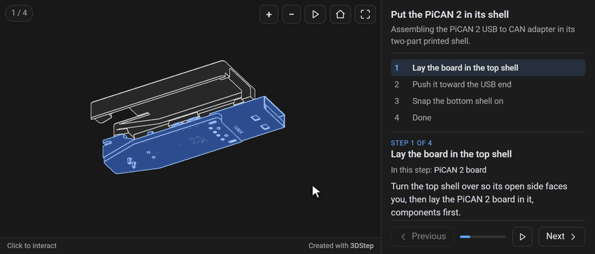

# 3DStep

> [!NOTE]
> 3DStep currently is in beta.

Step-by-step interactive 3D assembly instructions for documentation sites. 3DStep turns a CAD assembly (STEP) into a page where each instruction shows the parts it installs, moves them into place with arrows and frames them from a good angle, and the reader can turn the model to look closer. It renders one self-contained HTML file you can open in a browser or embed in an MkDocs or Zensical site.



*Assembly instructions for a PiCAN 2 USB to CAN adapter going into its printed shell — press Next and each part moves into place, or drag the view to look closer. [Try it live](https://doctools.isiks.tech/3dstep/examples/assembly/).*

## Quick start

Open **<https://3dstep.isiks.tech>**, import your STEP file, build the steps (which parts show, where they move from, what is highlighted, arrows, labels, a camera and a text for each), and press **Generate**. The designer reads the CAD file and renders the page in your browser, so your files never leave it. **Save project** keeps the project: a `.toml` file and one `.glb` per imported model, side by side.

To regenerate pages as an assembly changes, or publish them from CI, install the command line tool (Python 3.9 or later). It renders the same file from a saved project:

```bash
pip install "git+https://github.com/xbst/3DStep.git@master"
3dstep assembly.toml          # writes assembly.3dstep.html
3dstep                        # opens the designer locally
```

To embed the pages in an MkDocs or Zensical site, use [md-iframe](https://github.com/xbst/md-iframe), which sizes the frame to the page and keeps it in step with the site's light and dark mode:

```markdown
{ type=iframe }
```

`examples/pican2/` is a finished project to start from: `3dstep examples/pican2/pican2.toml`.

## Documentation

**<https://doctools.isiks.tech/3dstep/>**: getting started, the designer, the command line and STEP conversion, embedding and publishing, and the project TOML, theme and page references.

## US-based PCB Assembly

3DStep was initially created to improve the assembly instructions in our product documentation at [Isik's Tech](https://store.isiks.tech/), and we decided to open-source it after realizing others could find it useful too.

We also moved to in-house PCB assembly in early 2025 after struggling to find a reliable and affordable US-based PCB assembler, and we recently launched a new PCB assembly service to help others with PCB assembly as well. We can often match or beat delivered costs from overseas. We have an estimator on our website so you can upload your BOM and get an instant estimate. [For more information, visit IsikPCB.com](https://isikpcb.com/)

## License

This project is licensed under GPL-3.0. See [LICENSE](LICENSE).

If you'd like to support the development of this and other open-source projects, you can donate on [GitHub Sponsors](https://github.com/sponsors/xbst/) or [Patreon](https://patreon.com/isikstech).
